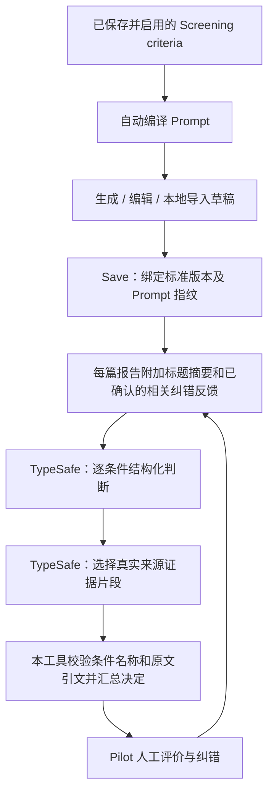

# Pilot screening：自动生成、编辑与导入 Screening prompt

实现版本 `screening-prompt-v1`，日期 2026-11-16。该功能将保存并启用的 Screening criteria 转为可查看、可编辑的执行提示词，供 TypeSafe/JEV 的标题摘要筛选使用。

## 用户操作

Pilot screening 标题旁依次提供 Eligibility criteria、Screening criteria、Screening prompt。

Eligibility criteria 不是编辑后两者的前置条件。没有上游标准时，Screening criteria 仍可打开，通过 Add criteria 添加、命名并保存纳排条件；不自动请求生成建议。Screening prompt 可先行输入、从本地导入、导出和保存，即使 Screening criteria 尚未保存。此时不能直接启动筛选；自动 Generate 需要有效的、已保存的 Screening criteria。稍后补充或修改标准后，自定义 Prompt 按原有版本保护要求复核保存。实际筛选依据已保存的 Screening criteria；没有上游标准时，向全文评估传递这些有效条件。

Eligibility criteria 弹窗提供 Clear，与旁边 Import from local、Edit eligibility criteria、Save 使用相同的文字按钮样式。确认清空后立即保存，无需再点击 Save；重新打开或刷新后保持为空。清空保留研究问题、附件与文献记录，旧标准及已有筛选结果按原有机制留存历史。保存的空标准会显式记录，不再回退加载旧标准；保存失败恢复原数据并提示错误，遇到并发标准变更时拒绝覆盖。普通编辑及导入仍需点击 Save 后生效。

嵌入预览启动及编辑均不得自动写入上游标准或标准库；只有独立 Eligibility 页面可以在启动时维护其标准库。弹窗打开时暂停源数据自动同步，避免重复去重和忙碌状态干扰操作。编辑器通过同源就绪消息初始化，无需等待字体、图片等完整加载；Clear 直接处理当前标准快照，不依赖嵌入编辑器加载成功。高度按预览内容测量，迟到的加载事件不得覆盖编辑或恢复已清空内容。操作被忙碌状态阻止时显示提示。

1. 可以先编辑两个弹窗；自动生成 Prompt 或开始筛选前，先保存 Screening criteria，保留本阶段需要判断的元素。
2. 每次打开 Screening prompt，编辑区均为空，不读取或回填以前保存、导入、生成的文本，Save 与 Export 暂不可用。只有点击 Generate、手动输入或本地导入才填充本次编辑区。Generate 根据当前已启用条件生成文本，包含研究问题背景、逐项条件、缺失信息处理、原文证据和纠错规则。打开弹窗本身不删除后台已保存的执行指令。
3. 可直接编辑文本，或点击 Import from local 导入 `.txt`、`.md`、`.json`。JSON 支持字符串，或含 `text`、`prompt`、`instructions` 字符串字段的对象；本工具导出的 JSON 可往返导入。文件最多 1 MB，提示词最多 20,000 字符。
4. Generate 将草稿恢复为根据当前标准生成的版本。点击 Export 打开 TXT / Markdown / JSON 格式菜单，选定后下载当前草稿；TXT 与 Markdown 保留提示词正文，JSON 另外携带版本及标准指纹。尚未保存的草稿不会自动生效。
5. Save 保存并应用当前文本。修改了实际指令时，旧 Pilot 和正式筛选结果归档，批准失效，需要重新预筛。保存本身不会调用模型或自动开始筛选。
6. Clear 与旁边按钮使用相同样式，立即清除当前草稿及后台已保存的 Prompt，重置导入文件、状态和导出菜单；重新打开或刷新后保持清空。显式清空标记阻止后台自动生成 Prompt，必须再次生成、输入或导入并 Save 才能恢复筛选。已有评估按原有机制归档，标准和导入记录保留；保存失败时恢复后台数据并保留当前草稿。

弹窗不显示生成原理说明、Execution preview 或归档机制长说明，这些机制继续在后台执行并记录。关闭或离开页面前，未保存修改会提示保留或放弃；解析或保存失败不会清空草稿。原始记录、已归档结果继续保留。

## 生成策略与研究依据

自动生成是确定性编译，不要求另一次大模型调用，不自动优化未知的准确率指标。它保留当前条件原文中的 AND、OR、否定、阈值及例外，逐项形成明确判断任务；生成、编辑与导入均不直接修改原始 Eligibility criteria 或已保存的 Screening criteria。

- Homiar 等在持续更新的系统综述中迭代开发按标准提问的 Prompt，并在保留数据及后续更新中检验；这支持针对标准的问题、人工反馈与版本验证。[原始研究，2025-07-22](https://pmc.ncbi.nlm.nih.gov/articles/PMC12306261/)
- 2026-10-19 的模型—提示策略比较发现，召回、精确率/F1的最优配置不同，提示效果依赖模型和任务。因此不默认把长推理、自我反思或某种 few-shot 方案称为普适最优。[Research Synthesis Methods，PMID 42895556](https://pubmed.ncbi.nlm.nih.gov/42895556/)
- 2026 年的结构化提示教程使用针对标准的反馈及迭代优化，并在其他综述数据上检验；本实现沿用人工确认的纠错规则和带来源的示例。[原始研究，PMID 42543845](https://pubmed.ncbi.nlm.nih.gov/42543845/)

这些研究使用的模型、语料和标签不同，不能将其性能数字直接用于本工具/JEV。当前 Pilot 的一致率不是独立数据上的敏感度；本次没有完成真实文献性能标定。[完整研究记录](../.claude/context/artifacts/research-reports/screening-prompt-research-2026-11-16.md)

## 实际执行与标准优先级



TypeSafe `/v1/systemone` 使用共享 `state` 和逐问题 `instructions`，不是自由聊天返回文本的接口。[官方说明](https://api.typesafe.ai/redoc)

每次请求的 `input.screeningPrompt` 包含规则版本、提示词指纹与完整保存文本；`criteria` 始终是当前启用后的结构化标准；`record` 是当前报告，`reviewerCalibration` 是选出的人工确认反馈。新版连接器在两次 `/systemone` 请求中都携带 `state.screeningPrompt`，并在分类和证据选择问题中明确要求读取它。

为兼容仍运行旧版连接器的进程，相同文本也进入原有 `stagePolicy`，旧连接器已将该字段传入两阶段共享 state。新版返回 Prompt 版本确认；记录中的 `promptDelivery` 为 `structured-prompt` 或 `stage-policy`，说明实际传递路径。服务运行中的 Python 代码需要重启才会加载新版连接器；前端兼容路径不依赖重启，也不会静默只保存到展示框。

可编辑文本指导如何应用标准；当前结构化标准、阶段边界、固定返回选项和原文证据要求仍保留。系统不能自动识别所有语义冲突，用户应在 Pilot 核对导入/编辑内容的实际影响。添加或修改纳排条件应通过 Screening criteria。

仅对当前启用条件判断 `met / not met / unclear`。排除需要至少一项明确不满足的条件及当前报告的原文证据，缺少排除证据时保留为 Maybe；模型输出的未知条件不会成为排除依据。Include 与 Maybe 均继续进入全文评估。

## 版本与保存保护

- Prompt 绑定 `criteriaSig`、`stageSig` 及模块版本；指纹是确定性变化标识，不是密码学真实性验证。
- 未编辑的默认版本随条件自动重新生成；已编辑/导入版本在标准变更后标为过期，保留原文，复核并保存或重新生成后再运行。
- `screeningPromptSnapshot` 保存当前完整文本及指纹；`screeningPromptArchives` 保存变更前的筛选结果、标准、报告和 Prompt。源/标准变更归档也保存其对应 Prompt 快照。
- 保存筛选标准时同步绑定生成版本，启动预筛前再次核对版本，准备阶段阻止重复启动。Prompt 变更后重置依赖结果并清除批准；原有批准也绑定 Prompt 指纹。Pilot 每轮和逐报告结果保留对应指纹，正式筛选继续使用同一规则。
- 弹窗打开时暂停后台自动刷新；Save 前重新读取上游内容并检查基准，发生并发标准变化时拒绝覆盖草稿。
- 保存失败恢复原工作区，未保存编辑内容仍留在弹窗。编辑文本通过 textarea/textContent 展示，不执行导入内容。
- 源数据及筛选结果的 JSON 导出均包含当前 Prompt 快照及 Prompt 变更归档；源数据 Export 仍保持原有完整去重集合的语义，因此重新预筛之前也能导出已归档记录。

## 验证

```sh
node tools/test_screening_prompt.cjs
node tools/test_screening_prompt_workflow.cjs
node tools/test_screening_criteria_clear.cjs
node tools/test_screening_stages.cjs
node tools/test_screening_stages_save.cjs
node tools/test_screening_calibration.cjs
node tools/test_model_policy.cjs
node tools/test_screening_source_sync.cjs
cd tools && python3 -B -m unittest test_typesafe_model.py
```

新增检查执行实际页面函数及编辑器：初始空白与显式生成、导入、三种格式导出往返、菜单键盘与外部关闭、草稿隔离、失败回滚、标准并发变化、两种阅读顺序的 TypeSafe 请求，以及 Pilot → 人工评价 → 批准 → 编辑 Prompt → 归档并重新预筛。Python 检查验证两阶段请求均携带 Prompt、非法输入不发请求、无有效排除引文时保留记录。模型调用均由合成结果模拟，没有以真实账户进行付费筛选或据此声称性能。

旧 `test_pilot_ai_review.cjs` 仍缺少现有 `AIMScreeningCriteriaDialog` 测试替身，在修改前的 HEAD 页面也失败；新增完整页面工作流检查覆盖本次 Prompt 与 Pilot 集成。本环境此前没有可用的交互浏览器，视觉操作验收须与函数及部署文件核验区分。
