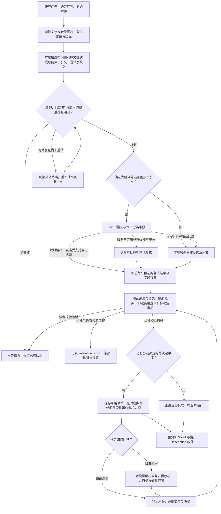

# AIM-STEP 从研究问题生成纳排标准的技术路线

依据 AIM-STEP `living-evidence` 提交 `53d32c0`，整理于 2026 年 11 月 19 日。本文描述 Eligibility 页面点击 **Generate** 后的机器生成流程。图中的模型分工对应 AIM-STEP 后端与 Ollama、TypeSafe/Jev 联用的路径。

系统先从原文提取候选要素，再独立核对候选表述与原文的含义。复核通过的要素仍须经过来源、语义和逻辑校验。程序从已接受的资格条件生成纳排标准，从研究关注内容和分析计划补全 Description。会改变筛选判断、且无法根据现有证据解决的问题才提交作者决定。

[打开矢量路线图](sources/纳排标准技术路线图.svg) · [下载高清 PNG](figures/纳排标准技术路线图.png) · [Mermaid 源文件](sources/纳排标准技术路线图.mmd)

## 端到端流程

## 1. 输入、来源与框架

页面接收输入框文字、语音识别后的文字，以及 DOCX、PDF、TXT、Markdown、CSV 或图片。可提取文字的附件进入文字路径。图片和需要图像识别的 PDF 页先逐项转录，转录结果须有正文并明确标记为可靠，才能继续。每个来源保存原文、来源标识、修订号和适用问题，附件可带文件名、页码与转录标记。[输入与附件适配](../../../eligibility.html) · [项目及来源登记](../../../app/eligibility/engine.js)

每个问题有独立 ID 和可用来源范围。系统同时区分综述方法、问题类型、组织框架和证据单位。框架提供字段定义，方法配置提供应当核对的决定。例如，PICO 可组织人群、干预、比较和结局，但选择该框架并不构成限定随机试验的来源。框架外有明确依据的条件仍可保留。[框架定义](../../../config/eligibility-frameworks.json) · [方法配置](../../../config/eligibility-review-profiles.json) · [配置解析](../../../app/eligibility/registries.js)

## 2. 本地模型抽取候选要素

程序按问题组织原始段落，尽量保持完整句子，再将段落组合为目标约 5500 字符的请求批次。为保护长句语义，单个完整句子可使批次超过目标。一个阶段最多并发两份独立批次，完成后按原始顺序合并。相同的方法配置字段只传一次，来源偏移按 Unicode 码点计算。[来源分段](../../../app/criteria-grounding.js) · [抽取与批次调度](../../../app/eligibility/model.js)

抽取结果包含候选 ID、维度、标准化文字、结构化数值、原文引文与版本、语义角色、信息状态、范围状态和纳入或排除方向。模型还提供问题主题、框架候选、需要澄清的事项及 `all_of`、`any_of`、`not` 等逻辑关系。

每个抽取请求约束为一个指定问题 ID。程序检查返回结构、要素字段和逻辑引用。单批 PICO 问题另有显式干预、比较和结局的覆盖检查。原文有据、仅被初标为 `Other` 的比较组先按同一套比较组识别规则判断是否已覆盖。对于可恢复的结构错误或适用覆盖检查中的遗漏，反馈具体原因，默认允许该批重新抽取一次。[请求结构与覆盖检查](../../../app/eligibility/model.js)

## 3. Jev 与本地模型独立复核语义

全部抽取结果合并后开始复核。每批最多 7 个候选，候选 JSON 序列化后的字符数合计最多 12500。各候选携带原文引文。批次按问题共享逻辑树，原问题短于 3500 字符时也一并提供完整问题。线上页面通过鉴权网关访问 AIM-STEP 后端，后端用 `eligibility-review-v1` 路由本阶段。直接连接 Ollama 或兼容端点的部署走提供方自身的复核路径。[前端模型适配](../../../eligibility.html) · [线上网关请求](../../../app/online-model.js) · [服务端路由](../../../tools/local_model_server.py)

对于初步标为 `explicit` 且带来源引文的候选，后端向 Jev 发送一批结构化单选题。每个候选评估下列六个字段，共用一次批请求。[复核字段与路由实现](../../../tools/eligibility_hybrid_review.py)

| 字段 | 复核内容 | 可选值 |
|---|---|---|
| `status` | 候选表述能否得到原文支持 | `supported`、`uncertain`、`contradicted` |
| `issue_type` | 疑义或错误来自哪里 | `none`、`ambiguous_source`、`unsupported_rewrite` |
| `information_status` | 原文提供了什么程度的信息 | `explicit`、`ambiguous`、`missing`、`conflicting` |
| `semantic_role` | 该内容用于筛选、描述关注点还是提供背景 | `eligibility_condition`、`review_focus`、`background_information`、`undecided` |
| `scope_status` | 来源如何界定此范围 | `restricted`、`unrestricted`、`unspecified`、`not_applicable` |
| `disposition` | 该条件决定纳入、排除或无方向 | `include`、`exclude`、`none`，合并时将 `none` 还原为空值 |

每个字段独立采信。Jev 的置信度和被选类别的概率必须同时达到 **0.95**。程序还检查答案类型、选项、完整概率分布和数值范围，所有选项概率之和与 1 的差值须不超过 0.02。该阈值用于分配复核工作，不表示候选有 95% 的临床正确率。[应答校验](../../../tools/typesafe_model.py)

- **六项均达标，且 `status=supported`、`issue_type=none`**。该候选完成本轮模型复核，高置信的复核值可更正初稿元数据，之后仍执行程序校验。
- **部分字段未达标，或有歧义、改写问题**。本地模型接手。已有高置信字段时，复核请求列出剩余字段并要求提供理由。若原文反驳已采信字段，本地模型也可纠正。最终核对候选 ID、六项字段及理由，并记录每项来自哪个模型。
- **信息含糊、缺失、冲突或缺少引文**。该候选直接进入本地复核。Jev 配置、网络、配额、20 秒超时或整批应答校验失败时，恢复整批本地复核。

本地服务默认使用 Ollama 的 `gemma4:31b-it-q8_0`，运行时可配置实际型号。Jev 使用服务端选择的型号，未指定时使用 `jev-latest`。审计记录实际返回的型号及所用字段。[本地调用](../../../tools/local_model_server.py) · [混合复核与审计](../../../tools/eligibility_hybrid_review.py)

## 4. 来源校验、标准构建与作者决定

程序将引文定位到指定问题和来源版本，检查严格不等号、单位、时间锚点、实施角色和条件例外，并验证逻辑树的引用。比较组别名和原文中的相互比较在这一阶段归入对应维度。只有被接受、角色为资格条件、范围为受限的适用要素才进入可执行标准。研究关注的结局、分析方法与资料层级单独保留，用于表述研究目的和计划。[来源与语义校验](../../../app/eligibility/domain.js) · [标准与逻辑构建](../../../app/eligibility/engine.js)

若某项歧义实际影响筛选，例如人群年龄边界、互相冲突的要求或条件之间的逻辑关系，草稿将相应问题绑定至要素 ID。预览把问题放在对应纳入或排除条件旁。研究关注点按来源保存在后台。若关注点确需作者判断，问题会在 Review topic 附近标出相关维度和对象。涉及框架或整个问题的决定分别放在 Framework 或 Review topic 附近。原文清楚的宽泛范围直接采用。未提及限制记为 `unspecified`，只有明确表示不限才记为 `unrestricted`。[待核对问题与展示位置](../../../app/eligibility/background.js) · [预览交互](../../../eligibility.html)

作者选择预设选项时，程序可直接应用。作者输入自由文字时，本地模型解析该答复针对的事项和要素，程序继续检查数值、修改范围和既有决定。每次应用决定均登记作者原话和来源，重建受影响的标准；尚未解决的事项继续开放。例如作者可决定保留原文“老年人”，也可明确给出数值边界。[作者答复入口](../../../app/eligibility/background.js) · [决定应用与重建](../../../app/eligibility/engine.js)

## 5. 缓存、失败处理与保存

| 位置 | 可复用的工作及边界 |
|---|---|
| 本地模型传输层 | 适用于结构化文字抽取、语义复核、作者自由文本解析。仅在传输时缩短来源和问题 ID，并在结果返回时还原。缓存键纳入项目、模型、输出结构、提示和输入，保留来源修订与既有决定，并将用于并发写入保护的基础修订号标准化。已完成条目保留 5 分钟，缓存目标容量 32 条。相同的在途请求共享执行，进行中的条目不会为腾出容量而被驱逐。解析错误、抽取题号错误、缺少所需顶层结果或因长度截断的应答不复用。 |
| Jev 应答缓存 | 以项目、服务访问凭据的指纹和完整请求体标识请求。完整且通过格式校验的结果可在 5 分钟内复用，容量 32 条。缓存命中后仍执行字段阈值判断。 |
| 在线等待 | 网关返回异步任务 ID 后，页面轮询该任务；在可恢复的轮询失败时按退避规则重试查询。任务已有 ID 时继续查询既有任务，避免因一次轮询失败而重复提交推理。 |

实现见[本地传输与缓存](../../../tools/eligibility_transport.py)、[Jev 缓存](../../../tools/eligibility_hybrid_review.py)和[在线任务生命周期](../../../app/online-model.js)。

错误按层处理。本地模型返回非 JSON 时，服务可先尝试修复格式，必要时再重新生成。浏览器对已识别的可恢复结构错误另有一次带反馈重试。每个模型步骤有独立超时。作者点击停止会中止等待；校验失败或任务中止不会用不完整的推理结果覆盖既有标准。模型输出与原文不符属于生成校验问题，原文本身确有两种影响筛选的解释才构成作者决定。[服务端 JSON 恢复](../../../tools/local_model_server.py) · [前端步骤控制](../../../app/eligibility/model.js)

项目记录按项目 ID 存于浏览器本地存储，保存来源、要素、标准、待决定事项、作者决定、修订、快照和模型调用审计。写入前同时检查项目修订及界面草稿签名。若作者已修改内容，旧任务不能覆盖新稿。多份关联记录写入发生异常时，程序尝试恢复写入前的状态。引擎区分三种结果状态：存在校验错误时为 `validation_error`，无校验错误但有未解决的阻塞事项时为 `needs_clarification`，两者均无时为 `final`。待澄清状态可以保存草稿。请求抛错或被取消与引擎返回带状态的草稿是不同路径。[项目状态与快照](../../../app/eligibility/engine.js) · [按版本保存](../../../app/eligibility/background.js)

## 6. 预览、导出与营养干预示例

页面显示研究主题、框架、纳入与排除标准，以及各自对应的待决定事项。**Description 是正文最后一项**。程序依据现有资格逻辑和有来源的研究关注点生成连贯英文，先表述研究对象与比较，再交代结局和分析目标。这个步骤直接从已复核数据组织文字。Word 导出沿用同一范围，将必要核对内容放入相应位置。[英文表述规则](../../../app/eligibility/methodology.js) · [预览与 Word 导出](../../../eligibility.html)

以住院老年人营养干预研究问题为例，以下为该研究问题在回归用例中覆盖的范围。表后的英文为使用此实现对先前保存的提取结果重新生成的 Description。[研究问题与期望要素](../../../tests/eligibility/fixtures/nutrition-ipd-nma.json) · [完整性回归](../../../tests/eligibility/scope-completeness.cjs)

| 原文要素 | 进入流程后的用途 |
|---|---|
| 住院老年人，已患营养不良或有发生风险 | 保留在人群条件中。“老年人”缺少数值边界时，核对项随该人群条件出现，等待作者指定阈值或保留原措辞。 |
| 各类营养干预 | 保留原文界定的干预范围，不自行设定实施途径、剂量或持续时间。 |
| 标准照护、安慰剂或干预彼此比较 | 在比较组下保留三种替代关系。“彼此比较”对应另一种符合条件的营养干预。 |
| 患者相关结局 | 作为结局关注点。仅凭此语句不要求所有纳入研究报告特定结局。 |
| 使用个体参与者数据进行网络荟萃分析并排序 | 作为分析计划及目标。若另有独立明确的 IPD 可得性纳入要求，再按其来源建立资格条件。 |

> We will include studies of nutritional interventions in hospitalised older people with established malnutrition or at risk of developing it. Eligible studies will compare the interventions with standard care or placebo, or with one another. We will assess patient-relevant outcomes and rank the interventions using a network meta-analysis of individual participant data.
