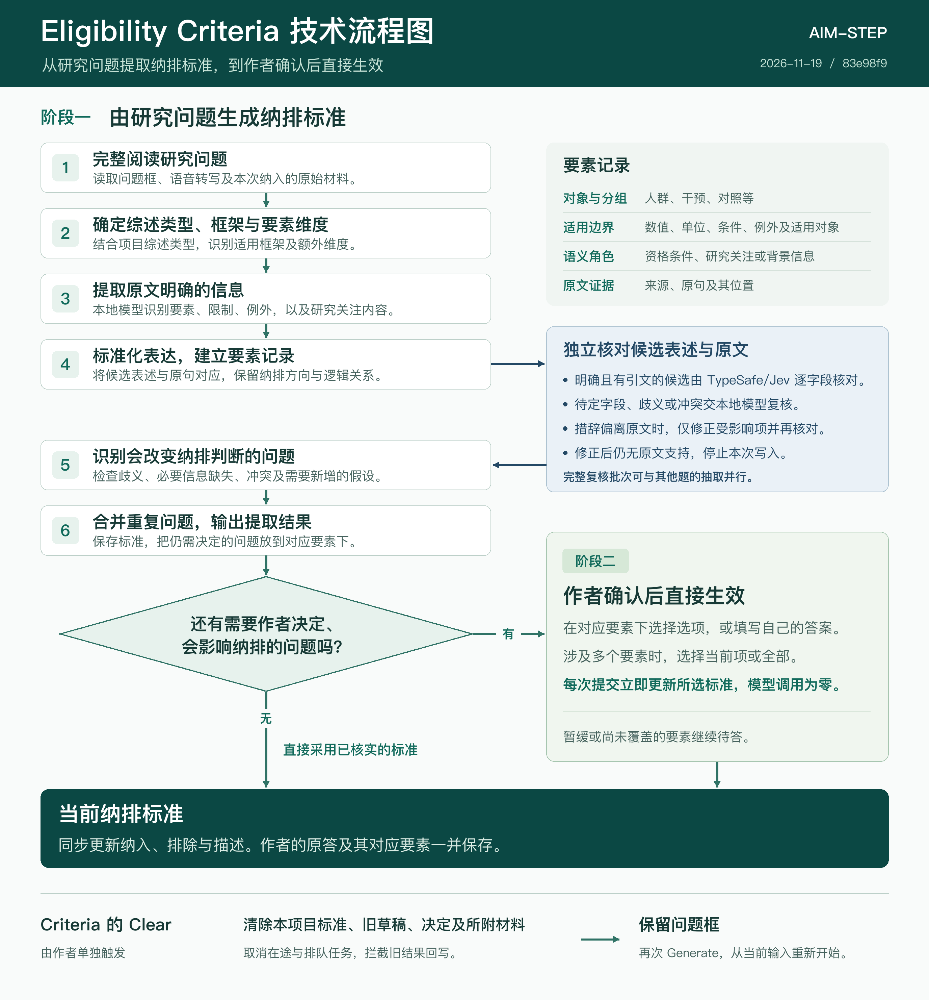

# Eligibility Criteria 技术流程图 · 2026-11-19

本图记录从研究问题生成纳排标准、再由作者处理待确认项的流程。对应应用版本 `20261119-criteria-release-3`。[查看实现版本 83e98f9](https://github.com/AIM-STEP/living-evidence/commit/83e98f9aa463383f39ecf78a8ae48eeac07bf715)

[打开高清 PNG](figures/eligibility-workflow.png) · [查看可编辑 Mermaid 源码](sources/eligibility-workflow.mmd)

## 如何读图

**阶段一。** 先完整阅读研究问题，结合综述类型确定框架与维度。提取时分别记录人群、干预、对照、限制、例外和研究关注，再把标准化表述对应到原文。仅作为研究目的提及的结局或分析方法归入后台记录。只有原文明示其为资格条件时，才据此限定纳排。

**来源复核。** 明确且有引文的候选由 TypeSafe/Jev 核对六个字段。各字段均达到 0.95 的置信度门槛，且判定原文支持、无问题时，可直接通过。待定字段或存在歧义、冲突的候选交本地模型复核。Jev 整体不可用时，本地模型承接复核。系统针对偏离原文的表述修正并再次核对，然后合并重复提问。多题运行时，一题已归并完毕的完整复核批次可与其他题的抽取重叠，模型请求共享两个并发位置。[来源复核实现](https://github.com/AIM-STEP/living-evidence/blob/83e98f9aa463383f39ecf78a8ae48eeac07bf715/tools/eligibility_hybrid_review.py) · [抽取与调度实现](https://github.com/AIM-STEP/living-evidence/blob/83e98f9aa463383f39ecf78a8ae48eeac07bf715/app/eligibility/model.js)

**阶段二。** 作者在相应要素下选定选项，或输入答案并点击 Apply。若问题涉及多个不同要素，可指定其中一项或全部。程序核对目标与当前版本后保存作者原答，当次提交即更新相应标准和描述，模型调用为零。例如，作者确认年龄下限后，该年龄条件立即生效，而同一人群下尚未确认的诊断定义仍可稍后处理。[人工决定与标准更新实现](https://github.com/AIM-STEP/living-evidence/blob/83e98f9aa463383f39ecf78a8ae48eeac07bf715/app/eligibility/engine.js)

**清空与重启。** 在 Eligibility Criteria 主页面确认 Clear 后，程序取消在途和排队的任务，清除当前项目的标准、历史草稿、人工决定及所附材料。问题框保留原文。再次点击 Generate 时从当前输入重新开始。清空前已经启动的任务无法回写。[清空实现](https://github.com/AIM-STEP/living-evidence/blob/83e98f9aa463383f39ecf78a8ae48eeac07bf715/app/eligibility-reset.js)
