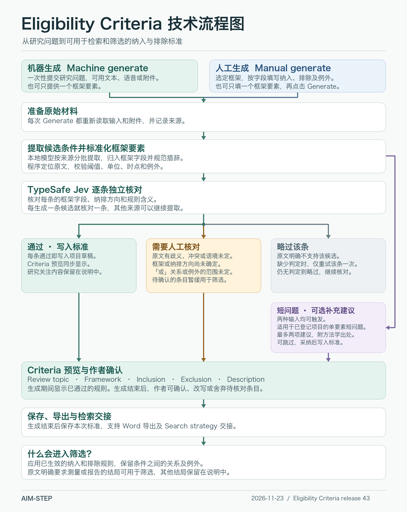

# Eligibility Criteria 技术流程图

[打开高清 PNG](figures/eligibility-workflow.png) · [制图源码](sources/workflow.py)

本图对应 `20261123-criteria-release-43`。机器生成接收一次性提交的研究问题。人工生成保留作者选定的框架及逐项填写的纳入、排除和例外。每次点击 **Generate** 都从当前原始材料重新提取和核对。需要重新提交的附件应在生成前附上。

本地模型将候选条件归入框架字段并给出规范措辞。程序把引文对回原文，校验阈值、等价单位、时间参照与明确的例外。候选条目就绪后，TypeSafe Jev 逐条核对框架字段、纳排方向及规则含义，其余来源仍可继续提取。

独立通过的条目逐条写入项目草稿，**Criteria** 预览同步更新。部分生成草稿可在重新打开工具时查看。生成完成后以本次完整标准交接检索、筛选和导出。明确不符合的条目略过，后续条目继续核对。若某条缺少判定，系统只重试该条一次，仍缺时略过。

原文有歧义或冲突、同一句引文的语境无法确定、框架或纳排方向未定时，系统会在 **Criteria** 预览中请求作者核对。若遗漏某条候选会改变「或」关系或例外的适用范围，关联条目也交作者核对。受影响的条目须经作者确认后才能用于筛选。

对符合条件的已登记项目，机器端一次性输入和人工端逐项填写都可触发单要素短问题建议。系统识别人工输入时，按作者填写的实际内容判断，保留原文及引文位置。**Criteria** 预览可显示最多两项带方法学出处的补充建议。作者可以采纳、补写或跳过，确认后才成为筛选规则。

作者对待确认项的选择直接应用到标准和预览，无需再次调用模型。点击 **Clear** 会保留问题框内容，清除该项目的标准、草稿和附件，并使清除前的任务无法回写。

[详细技术说明](../source-grounded-extraction.md) · [提取记录本](../extraction-notebook.md)
