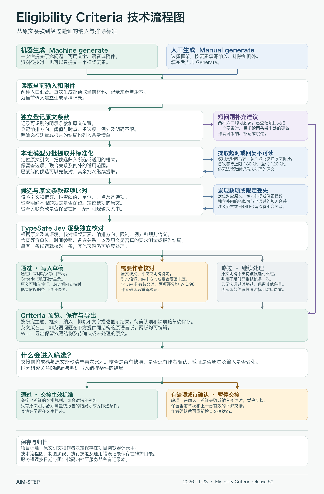

# Eligibility Criteria 技术流程图

[高清 PNG](figures/eligibility-workflow.png) · [制图源码](sources/workflow.py) · [前一张流程图与说明](../2026-11-22/README.md)

图稿日期为 2026-11-23，对应在线工具 `20261123-criteria-release-59`，核对依据为版本库提交 `001b7b0`。

- 机器生成一次性接收研究问题，也可使用语音或附件。人工生成接收作者选定的框架和逐项填写的规则。两种入口汇合后，程序独立登记可识别的原文条款，本地模型分批提取并标准化框架要素。
- 候选需对回原文。程序检查措辞是否保留原文明确的阈值、单位、时点、备选项、例外和不限条件。发现缺项时定向补提或修订该条措辞。独立补提结果可与其他已通过规则合并。提取超时或回复不可读时，改用较短的请求，多片段批次沿原文边界拆分后重试。
- TypeSafe Jev 在候选就绪后按条核对。通过的条目即时写入草稿。无依据或判定不足的条目略过，仍缺的明示条款显示对应原文。原文歧义、冲突、引文归属或组合关系未定时，交作者核对。仅由 Jev 提出歧义时，置信度和该判定的概率均须达到 0.98。作者确认可直接写回并重新验证。
- 已登记项目只给一个框架要素时，两种入口都可触发最多两条带方法学出处的可选建议。作者采纳后才写入生效规则。
- Criteria 保存已核对结果及待确认或未处理的原文。非英语问题同时显示可编辑的英文版和原语言版，Word 导出使用相同结构。交接前检查成稿完整性、作者确认、验证状态和输入是否变化。明确要求测量或报告的结局可以进入筛选规则，其他结局写入文字描述。
- 点击 **Clear** 会保留问题框内容，清除当前生成结果、草稿和附件。清除前的任务无法回写。

执行技能、错误与反馈记录本，以及项目和服务端保存位置见[维护目录](../README.md)。

在 macOS 和 Pillow 环境中，从仓库根目录运行 `python3 technical-roadmaps/eligibility-criteria/2026-11-23/sources/workflow.py` 可重新生成图片。
