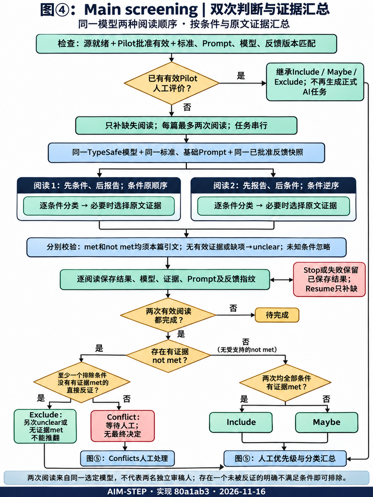
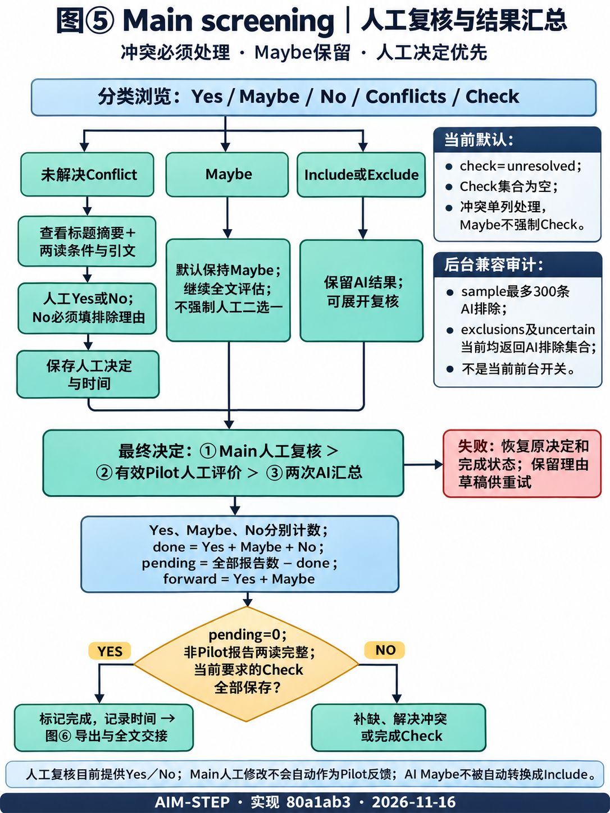
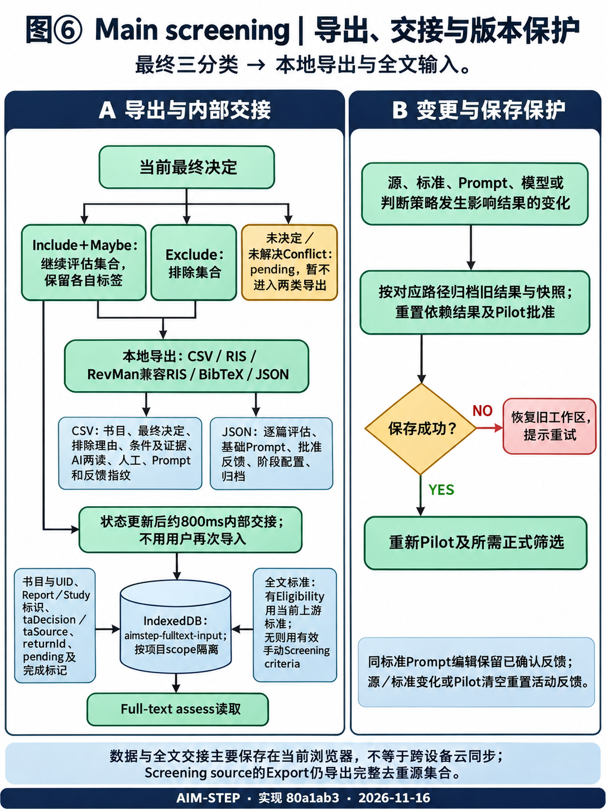

# Main screening 技术流程图 · 2026-11-16

依据实现：`80a1ab3c68621d64292567e881f1d0c47de89f39`。图片由本会话内置 imagegen 绘制并检查；Mermaid 源码和在线文字细节用于核对精确分支、字段及实现范围。

| 图 | PNG 图片 | 可编辑源码 | 内容 |
|---|---|---|---|
| 4 双次判断与证据汇总 | [查看图片](figures/04-main-two-readings.png) | [Mermaid](sources/04-main-two-readings.mmd) | 有效 Pilot 评价继承、同一模型两次阅读、逐条件归一化与冲突判定。 |
| 5 人工复核与结果汇总 | [查看图片](figures/05-main-review-summary.png) | [Mermaid](sources/05-main-review-summary.mmd) | 冲突处理、Maybe 保留、有效人工决定优先级、分类浏览与完成条件。 |
| 6 导出、全文交接与版本保护 | [查看图片](figures/06-main-export-handoff.png) | [Mermaid](sources/06-main-export-handoff.mmd) | 继续评估集合、排除集合、导出证据、IndexedDB 内部交接及归档保护。 |

### 4. 双次判断与证据汇总

### 5. 人工复核与结果汇总

### 6. 导出、全文交接与版本保护

## 查看、下载与实现依据

- [浏览器查看六张图，逐图展开文字技术细节](https://aimsetp.com/pilot-main-screening-flowcharts.html)
- [下载全部图片、离线阅读页、文字细节和流程源码](https://aimsetp.com/docs/pilot-main-screening-flowcharts/pilot-main-screening-flowcharts.zip)
- [绘图提示词与校正记录](drawing-prompts.txt)
- [Prompt、判断与反馈机制的技术说明](../../../docs/PILOT_SCREENING_PROMPT.md)
- [对应页面代码](https://github.com/AIM-STEP/living-evidence/blob/80a1ab3c68621d64292567e881f1d0c47de89f39/title-abstract-screening.html)
- [反馈记忆模块](https://github.com/AIM-STEP/living-evidence/blob/80a1ab3c68621d64292567e881f1d0c47de89f39/app/screening-calibration.js)

## 阅读重点

1. 有效 Pilot 人工评价直接继承；其余报告由同一模型以两种顺序阅读，不等于两个独立模型。
2. 有证据的排除不会被另次 unclear 或无证据 met 推翻；直接矛盾按逐条件证据处理。
3. 默认冲突需人工解决，Maybe 继续全文且不强制 Check。Main 人工复核当前只有 Yes/No；其修改不自动进入 Pilot 反馈记忆。
4. 继续评估集合为 Include+Maybe；未解决冲突保持 pending。内部交接保存当前浏览器，不等于云端跨设备同步。
5. 图④校正 Exclude 不进入 Conflicts、Pilot 继承绕过正式AI；后台兼容审计策略的实际范围在图⑤和文字表中注明。

这些图是软件实现说明，不是独立真实文献性能验证。源代码固定到上述提交；在线阅读页不访问用户项目或文献数据。
