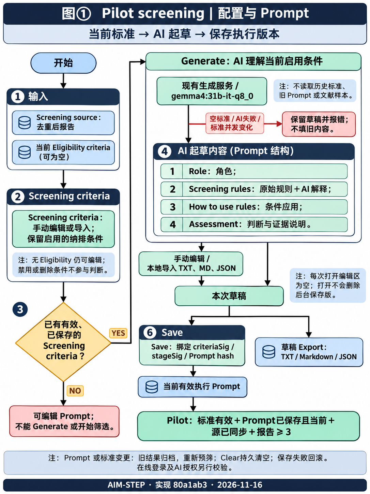
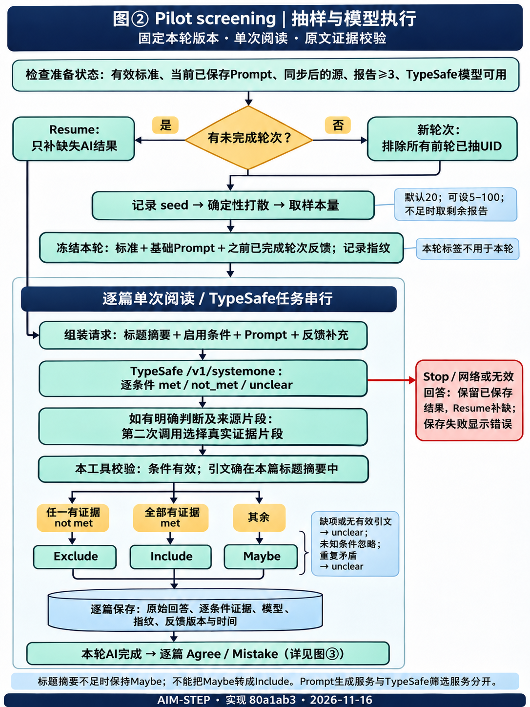
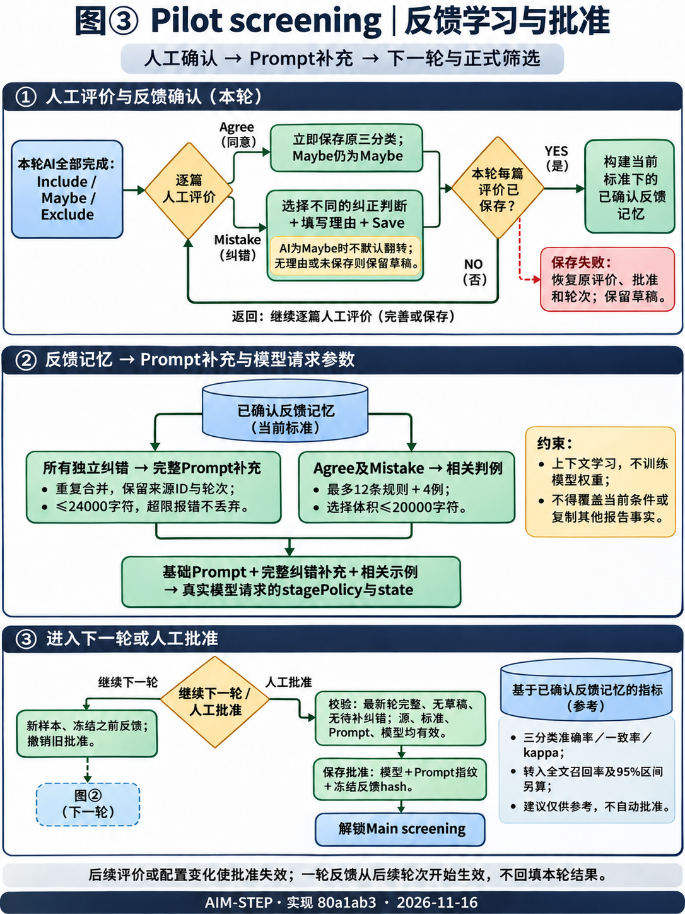

# Pilot screening 技术流程图 · 2026-11-16

依据实现：`80a1ab3c68621d64292567e881f1d0c47de89f39`。图片由本会话内置 imagegen 绘制并检查；Mermaid 源码和在线文字细节用于核对精确分支、字段及实现范围。

| 图 | PNG 图片 | 可编辑源码 | 内容 |
|---|---|---|---|
| 1 配置与 Prompt | [查看图片](figures/01-pilot-configuration.png) | [Mermaid](sources/01-pilot-configuration.mmd) | 当前标准、独立编辑、AI 四部分起草、保存与版本保护。 |
| 2 抽样与模型执行 | [查看图片](figures/02-pilot-execution.png) | [Mermaid](sources/02-pilot-execution.mmd) | 不重复抽样、本轮冻结、TypeSafe 两阶段调用、三分类证据门控与续跑。 |
| 3 反馈学习与批准 | [查看图片](figures/03-pilot-feedback-approval.png) | [Mermaid](sources/03-pilot-feedback-approval.mmd) | 人工纠错、完整 Prompt 补充、相关示例、三分类统计、批准和正式筛选入口。 |

### 1. 配置与 Prompt

### 2. 抽样与模型执行

### 3. 反馈学习与批准

## 查看、下载与实现依据

- [浏览器查看六张图，逐图展开文字技术细节](https://aimsetp.com/pilot-main-screening-flowcharts.html)
- [下载全部图片、离线阅读页、文字细节和流程源码](https://aimsetp.com/docs/pilot-main-screening-flowcharts/pilot-main-screening-flowcharts.zip)
- [绘图提示词与校正记录](drawing-prompts.txt)
- [Prompt、判断与反馈机制的技术说明](../../../docs/PILOT_SCREENING_PROMPT.md)
- [对应页面代码](https://github.com/AIM-STEP/living-evidence/blob/80a1ab3c68621d64292567e881f1d0c47de89f39/title-abstract-screening.html)
- [反馈记忆模块](https://github.com/AIM-STEP/living-evidence/blob/80a1ab3c68621d64292567e881f1d0c47de89f39/app/screening-calibration.js)

## 阅读重点

1. Eligibility 可为空；有效 Screening criteria 与明确保存且版本当前的 Prompt 是执行前提。Prompt 起草使用现有生成服务，筛选使用外接 TypeSafe/JEV。
2. Pilot 一篇一次阅读；TypeSafe 分类和必要的证据选择属于这一次阅读的两个 API 阶段。
3. 每轮使用此前完整轮次的反馈。所有独立纠错进入补充，Agree 作为正确判例；不训练模型权重、不新增纳排条件。
4. 三分类判断与转入全文指标分开，建议指标不会自动批准。正式筛选使用人工批准时冻结的模型、Prompt 和反馈版本。
5. 图②采用校正版，Resume 绕过重新抽样和冻结；图③校正批准后不自动返回下一轮。

原有简图 [screening-prompt.mmd](screening-prompt.mmd) 保留为早期路线记录；完整当前实现以本次三图及配套文字为准。

这些图是软件实现说明，不是独立真实文献性能验证。源代码固定到上述提交；在线阅读页不访问用户项目或文献数据。
