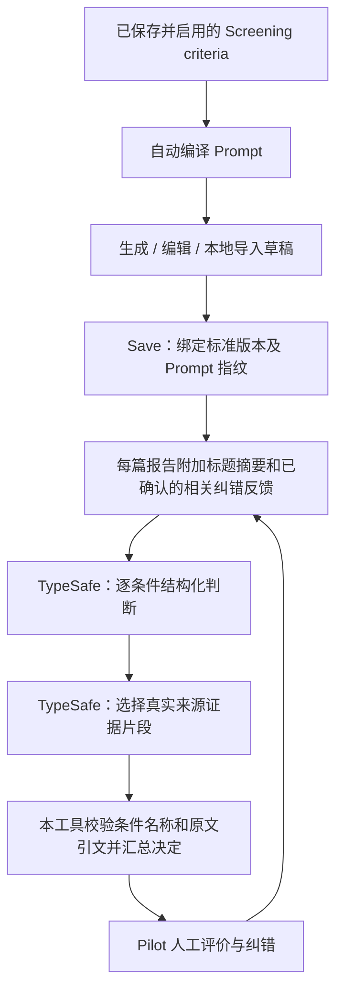

# Pilot screening：Screening prompt 技术路线

日期：2026-11-16；实现版本：`screening-prompt-v1`。

Prompt 自动引用已保存且启用的筛选标准，支持编辑及 TXT、Markdown、JSON 本地导入，保存后用于实际 TypeSafe/JEV 筛选请求。

- [可编辑流程源码](screening-prompt.mmd)
- [操作、执行路径与版本说明](../../../docs/PILOT_SCREENING_PROMPT.md)
- [研究依据](../../../.claude/context/artifacts/research-reports/screening-prompt-research-2026-11-16.md)

Prompt 变化会归档旧筛选结果并要求重新 Pilot；规则和研究性能的适用范围详见技术说明。
