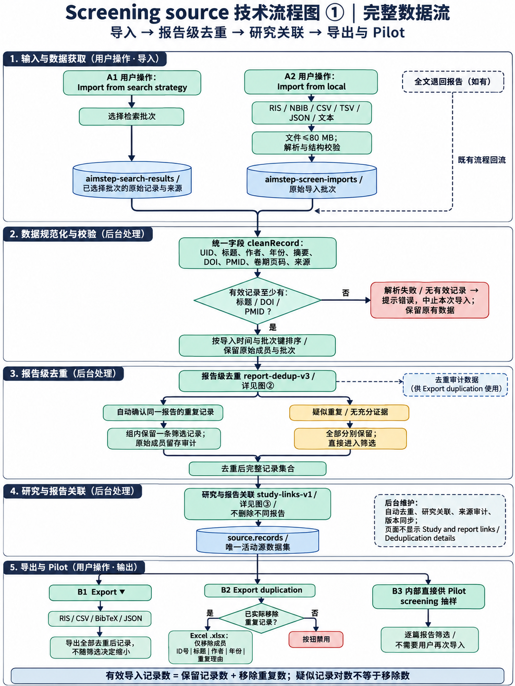
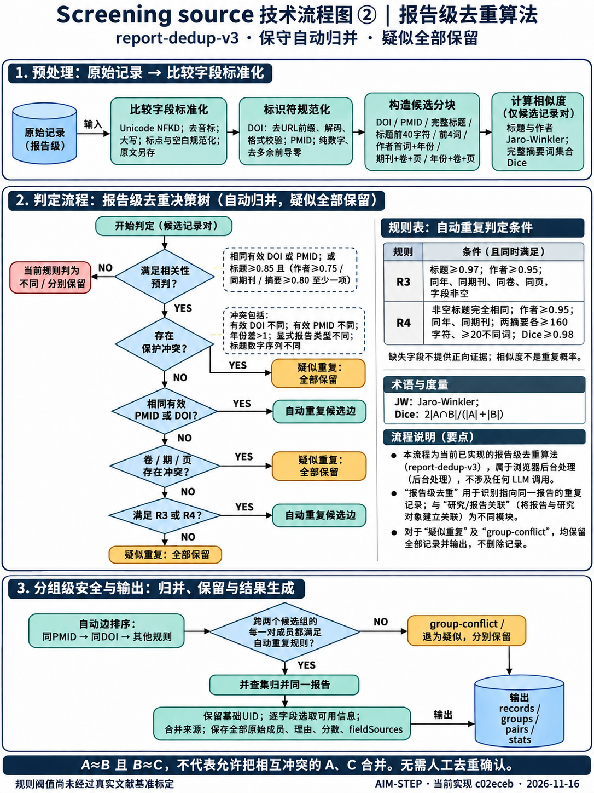
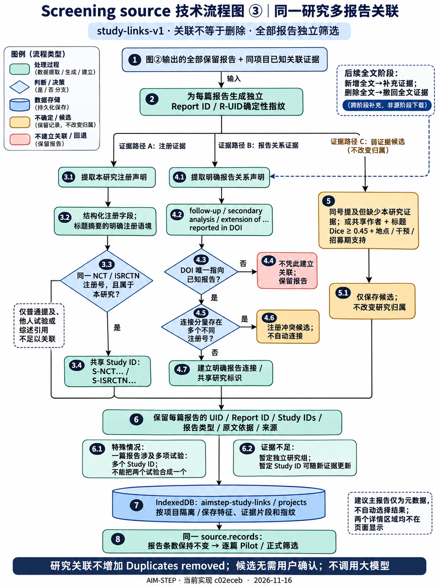
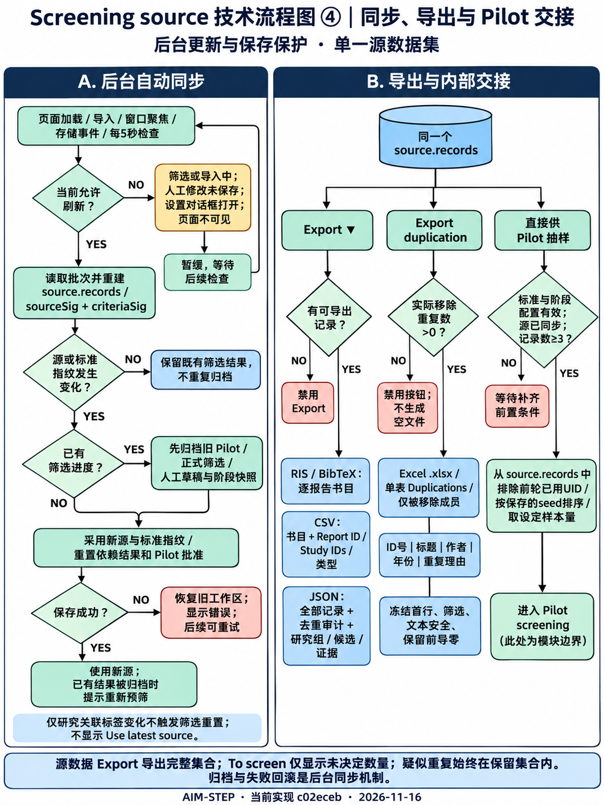

# Screening source 技术流程图 · 2026-11-16

依据实现版本：`c02eceb`。流程图描述该版本的实际软件流程，图片通过本会话内置图像生成工具绘制；Mermaid 文件保留可编辑的流程与精确字段、阈值。

## 四张流程图

| 图 | PNG 图片 | 可编辑源码 | 内容 |
|---|---|---|---|
| ① 完整数据流 | [查看图片](figures/01-overview.png) | [Mermaid](sources/01-overview.mmd) | 两类导入、校验与清洗、去重、关联、导出和 Pilot 入口 |
| ② 报告级去重算法 | [查看最终图片 v2](figures/02-report-deduplication-v2.png) | [Mermaid](sources/02-report-deduplication.mmd) | 分块、相似度、冲突保护、R1–R4、跨组全对检查及字段来源 |
| ③ 同一研究多报告关联 | [查看图片](figures/03-study-report-linkage.png) | [Mermaid](sources/03-study-report-linkage.mmd) | 注册声明、明确 DOI 关系、候选关系、研究与报告标识、全文更新 |
| ④ 同步、导出与 Pilot 交接 | [查看图片](figures/04-sync-export-pilot.png) | [Mermaid](sources/04-sync-export-pilot.mmd) | 自动刷新、归档、失败回滚、导出格式、Excel 条件和 Pilot 抽样 |

### ① 完整数据流

### ② 报告级去重算法

### ③ 同一研究多报告关联

### ④ 同步、导出与 Pilot 交接

## 查看与下载

- [在线查看及放大](https://aimsetp.com/screening-source-flowcharts.html)
- [下载全部图片与流程源码](https://aimsetp.com/docs/screening-source-flowcharts/screening-source-flowcharts.zip)
- [绘图提示词及图②字段校正记录](drawing-prompts.txt)
- [报告级去重技术说明](../../../docs/SCREENING_SOURCE_DEDUPLICATION.md)
- [研究与报告关联技术说明](../../../docs/STUDY_REPORT_LINKAGE.md)

## 关键规则与范围

1. “后台处理”运行在浏览器中，项目数据在 IndexedDB 中按 scope 隔离；导入、去重与研究关联本身不调用大模型。
2. 同一报告的重复数据库记录可以自动归并；同一研究的不同报告全部保留并分别筛选。
3. 疑似重复全部保留，不要求用户确认合并、保持分开或暂不处理。
4. 源 Export 输出完整保留集合；Export duplication 仅输出实际移除的重复成员，Excel 固定五列，无移除重复记录时禁用。
5. Study and report links 与 Deduplication details 页面区域已移除，关联证据与去重审计继续在后台保存。
6. 图②使用最终校正版 v2：去重引擎原生输出字段为 `pairs`，审计 JSON 中对应字段名为 `possiblePairs`。
7. 相似度阈值是该版本的工程规则，尚未经过独立真实文献基准标定；源码是核对详细数值与字段名的配套资料。
